# 🚕 Robotaxi Dispatch Simulator

**A live, interactive simulator of an autonomous ride-hailing fleet, built to answer one question: *how should a robotaxi fleet dispatch, charge and maintain its cars?***

Run a fleet of robotaxis on a real city map (San Francisco, Las Vegas, Austin, Miami, Los Angeles), watch every car drive in 3D, then compare dispatch and maintenance strategies on wait time, utilization, breakdowns and battery health.

<p align="center">
  
</p>


> Screenshots on this page use the built-in synthetic grid so they render offline. Pick **San Francisco** (or any real city) in the app for real streets, 3D buildings and satellite imagery.

---

## Table of contents

1. [Highlights](#highlights)
2. [Screenshots](#screenshots)
3. [How it works](#how-it-works)
   - [The big picture](#the-big-picture)
   - [The simulation loop](#the-simulation-loop)
   - [Life of a robotaxi](#life-of-a-robotaxi)
   - [Dispatch strategies](#dispatch-strategies)
   - [Reliability and maintenance](#reliability-and-maintenance)
   - [Battery and charging](#battery-and-charging)
   - [Real cities from OpenStreetMap](#real-cities-from-openstreetmap)
4. [System design](#system-design)
   - [Tech stack](#tech-stack)
   - [Components and data model](#components-and-data-model)
   - [Request flow](#request-flow)
   - [Frontend rendering pipeline](#frontend-rendering-pipeline)
   - [Design decisions](#design-decisions)
5. [API reference](#api-reference)
6. [Results](#results)
7. [Getting started](#getting-started)
8. [Configuration](#configuration)
9. [Project structure](#project-structure)
10. [Limitations and roadmap](#limitations-and-roadmap)

---

## Highlights

| | |
|---|---|
| 🗺️ **Real cities** | Road networks from OpenStreetMap for 5 US cities, plus an instant offline grid. Add your own city with one line of config. |
| 🧭 **Cinematic map** | 3D tilted view with buildings, satellite toggle, orbiting camera, light and dark themes. Cars glide smoothly at 60 fps and show glowing route lines to their pickup, dropoff or charger. |
| 🧠 **Three dispatch strategies** | Greedy nearest-car, batched optimal assignment (Hungarian algorithm) and demand-aware repositioning. |
| 🔧 **Reliability model** | Each car wears out and fails on a Weibull curve. A failure strands the rider. Compare reactive repair with predictive maintenance. |
| 🔋 **Battery and charging** | Cars drain as they drive, route to the least-busy charger, queue for plugs and unplug at 90%. Every car's battery is visible. |
| 📊 **Policy comparison** | One click runs all six policy combinations headless across several random seeds and highlights the winner. |
| ⚡ **Fast** | Lazy, cached shortest-path routing keeps city-scale road graphs (thousands of intersections) responsive. |
| ✅ **Tested** | 13 automated tests cover the simulation, the OpenStreetMap adapter (offline, against real OSMnx output) and the API. |

---

## Screenshots

<table>
  <tr>
    <td colspan="2"><br><sub><b>San Francisco, 3D street map.</b> Tilted side angle over real OpenStreetMap roads and extruded buildings, with robotaxis and charger markers.</sub></td>
  </tr>
  <tr>
    <td width="50%"><br><sub><b>Top-down, light theme.</b> Cars are colored by state; lines show where each car is heading.</sub></td>
    <td width="50%"><br><sub><b>3D view, light theme.</b> Tilt, rotate and orbit the camera.</sub></td>
  </tr>
  <tr>
    <td><br><sub><b>Charging stations and per-car batteries.</b> Plug usage per charger, every car's battery sorted lowest first.</sub></td>
    <td><br><sub><b>Policy comparison.</b> Six policy combinations, averaged over seeds, best one highlighted.</sub></td>
  </tr>
</table>

<p align="center"><br><sub><b>Fleet bar.</b> Total robotaxis, a live breakdown by state, charging load, average battery, riders waiting and utilization.</sub></p>

**Car colors:** 🟢 with passenger · 🟡 heading to rider · 🔵 available · 🟣 repositioning · 🩵 going to charge · 🟩 charging · ⚪ maintenance · 🔴 broken down · 🟠 waiting rider (pulsing).

---

## How it works

### The big picture

The browser is a thin, build-free client. All of the simulation runs in Python on the server, and the browser polls it for snapshots, then animates between them.

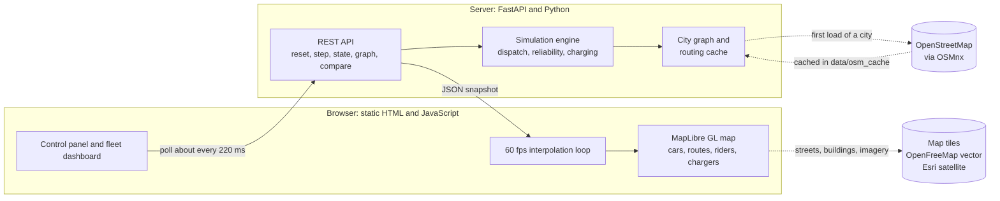

### The simulation loop

The engine advances in 2-second ticks. Each tick spawns demand, assigns cars to riders, handles charging, then moves every car one step.

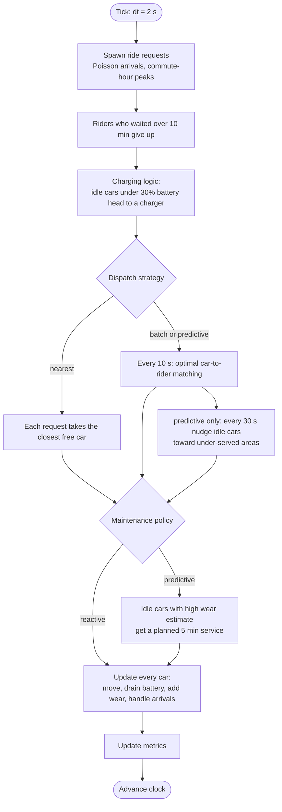

What "update every car" does:

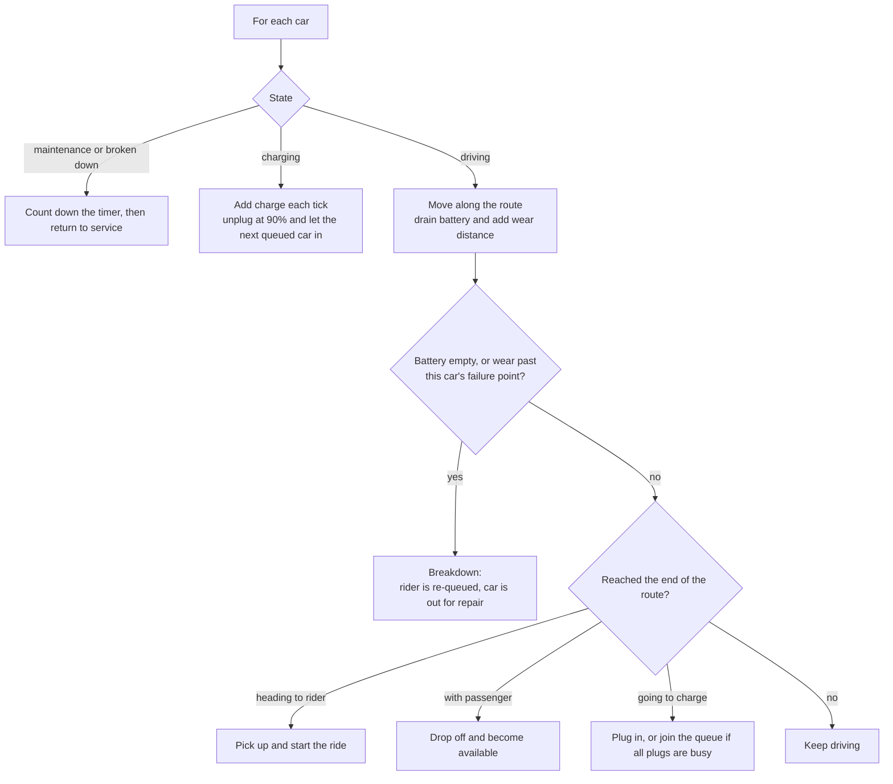

### Life of a robotaxi

Every car is a small state machine:

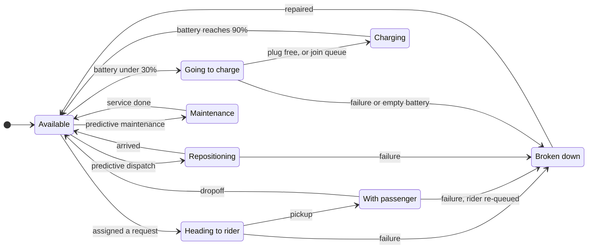

### Dispatch strategies

| Strategy | Idea | Strength | Weakness |
|---|---|---|---|
| `nearest` | Process requests in order. Each takes the closest free car. | Simple, instant. | Locally greedy: an early rider can steal the car a later rider needed more. |
| `batch` | Every 10 s, collect all waiting riders and free cars and solve the assignment problem optimally. | Minimizes total pickup time across the fleet, so waits drop sharply. | Slight delay of up to 10 s before a car is assigned. |
| `predictive` | `batch`, plus every 30 s nudge up to 3 idle cars toward neighborhoods with more expected demand than cars. | Aims to shorten future pickups. | Currently has no measurable effect (see [Results](#results)). |

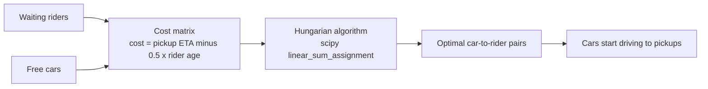

The `0.5 x rider age` term is a fairness bonus: the longer someone has waited, the more it pays to serve them now, which prevents starvation of unlucky riders.

### Reliability and maintenance

Every car has a hidden distance at which it will fail, drawn from a **Weibull distribution** (shape 2.2, scale 90 km). Shape above 1 means wear-out failures: the longer since the last service, the more likely a failure. The simulator tracks kilometers driven since the last service (the car's *wear*).

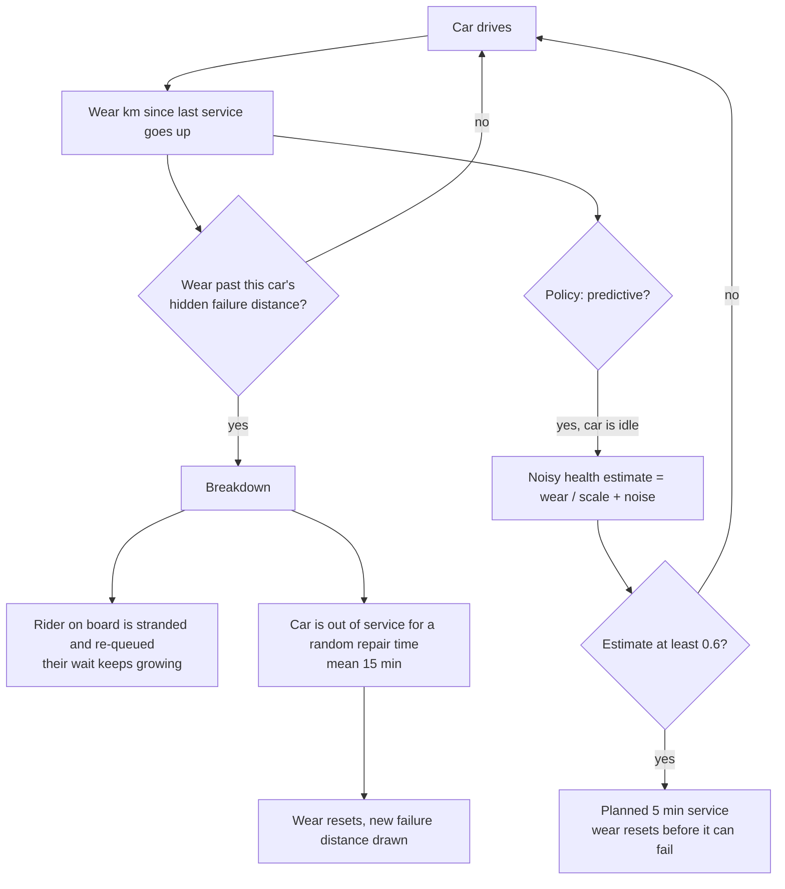

Predictive maintenance trades a little capacity (cars are parked for planned service) for far fewer surprise breakdowns, which strand riders. The [results](#results) quantify this.

### Battery and charging

Each car has a battery (90 km range). Chargers are spread across the city, biased toward where demand is, with a few plugs each.

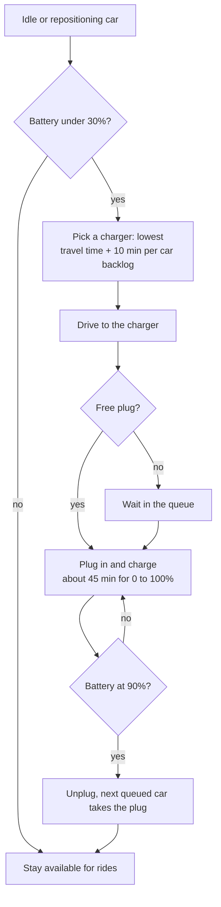

- **Charger placement:** farthest-point sampling weighted by demand, starting at the city center, so stations are spread out but near the action. Default: `max(2, ceil(cars / 8))` stations.
- **Plugs:** `ceil(0.25 x cars / stations) + 1` per station. Deliberately scarce, so queues sometimes form.
- **Failure mode:** a car that runs completely dry is treated as a breakdown (towed, rider re-queued). In normal runs the charging policy avoids this.

### Real cities from OpenStreetMap

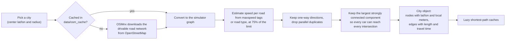

The conversion is exercised in the test suite offline, by feeding OSMnx a small hand-made `.osm` file that includes one-way streets and `mph` speed limits.

---

## System design

### Tech stack

| Layer | Technology | Why |
|---|---|---|
| Simulation | **Python**, **NumPy**, **SciPy** | Vectorized math, `linear_sum_assignment` for optimal dispatch |
| Road graph and routing | **NetworkX**, **OSMnx** | Dijkstra shortest paths; real road networks from OpenStreetMap |
| API server | **FastAPI** + **Uvicorn** | Small, typed, auto-validated REST API that also serves the frontend |
| Frontend | Vanilla **JavaScript**, HTML, CSS | No build step: clone and run. Library is vendored, so it works offline |
| Map rendering | **MapLibre GL JS** (WebGL) | Smooth vector maps, 3D buildings, custom GPU-drawn layers |
| Basemaps | **OpenFreeMap** (vector, 3D buildings), **Esri World Imagery** (satellite) | Free, no API key |
| Tests | **pytest**, FastAPI `TestClient` | Simulation, OSM adapter and API are covered |
| Screenshots | **Playwright** | `scripts/screenshots.py` regenerates this page's images |

### Components and data model

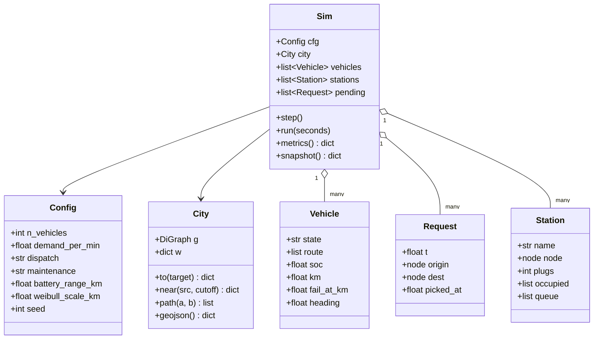

- `sim/city.py` owns the road graph, demand weights and all routing queries. It is shared across simulations, so caches are reused (the headless comparison runs 18 simulations on one `City`).
- `sim/engine.py` owns simulation state and rules. It never touches the network or the browser.
- `app/main.py` is a thin HTTP layer holding one live `Sim` in memory.

### Request flow

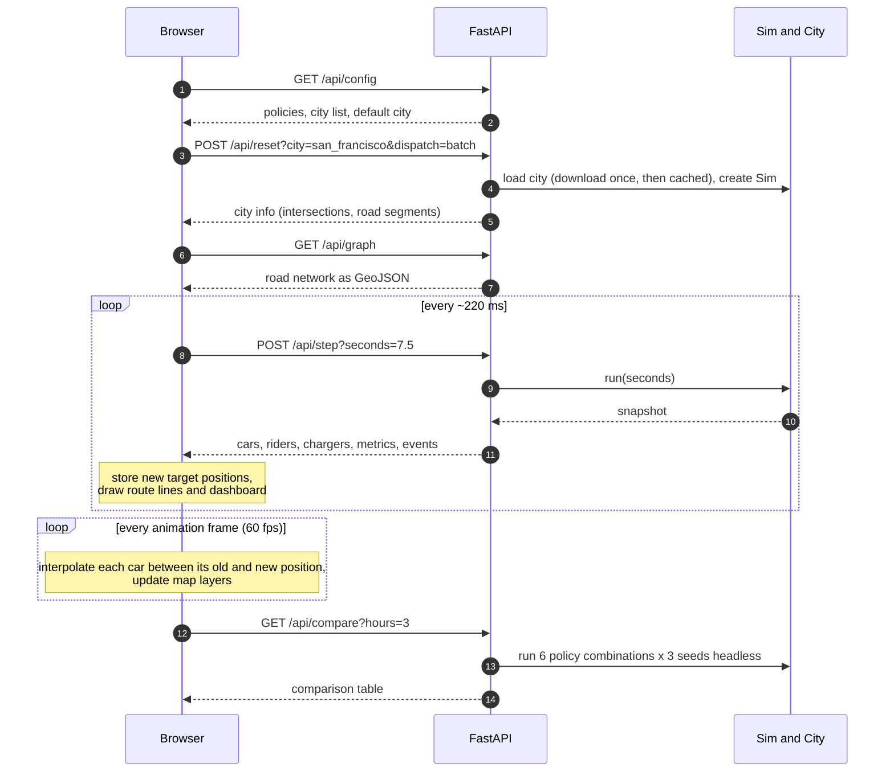

### Frontend rendering pipeline

The server sends positions a few times per second. The browser fills in the frames in between, so motion looks continuous.

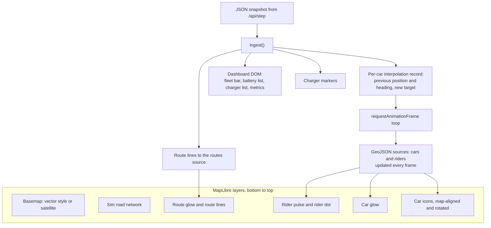

Details worth knowing:

- Cars are a **symbol layer** with `icon-pitch-alignment: map`, so they lie flat on the road and tilt with the 3D camera, instead of floating as HTML markers.
- The **dark theme** recolors the light vector style on the fly by inverting lightness while keeping hue, with special rules for roads, labels and buildings.
- **Interaction:** two-finger twist (Safari, iPad, phone) or Option + two-finger swipe (Chrome) rotates and tilts the camera; hover a car for its battery and wear.

### Design decisions

| Decision | Alternatives | Why this way |
|---|---|---|
| Simulation on the server, browser polls | Run the sim in JavaScript | Python's scientific stack (SciPy, NetworkX, OSMnx) is the right tool, and the same engine powers the headless policy comparison |
| Polling, not WebSockets | WebSockets / SSE | Simplest thing that works. One in-flight request, no connection state, trivially testable |
| Lazy cached Dijkstra | Precompute all-pairs paths | All-pairs is O(n²) memory. Fine for 200 nodes, unusable for a real city (thousands of nodes). Caches are LRU-bounded |
| Hungarian algorithm for `batch` | Greedy, auction, ILP | Optimal for the assignment problem and fast at this scale, with one line via SciPy |
| Weibull for failures | Constant failure rate | Wear-out behavior (increasing hazard) is what makes preventive maintenance meaningful |
| MapLibre + OpenFreeMap | Google Maps, Apple Maps, Mapbox | No API key or billing, vector tiles with 3D buildings, GPU custom layers. Google's terms also forbid using its tiles in other map libraries |
| No frontend build step | React / Vite | One HTML file plus a vendored library. Clone, install, run |
| Single in-memory `Sim` | Per-session state, database | A demo has one viewer. A multi-user deployment would key sims by session ID |

**Performance:** routing uses single-source Dijkstra with an LRU cache keyed by destination (500 entries) and bounded-radius neighborhood caches (6,000 entries). The engine runs a full 4-hour, 30-car simulation in about half a second. Because a `City` is shared, the headless comparison (6 policy combinations x 3 seeds = 18 simulations) takes about 4 seconds.

---

## API reference

Base URL: `http://localhost:8000`. All responses are JSON. Interactive docs are generated by FastAPI at **`/docs`**.

| Method | Path | Parameters | Returns |
|---|---|---|---|
| `GET` | `/` | | The web app |
| `GET` | `/api/config` | | Available policies, cities, default city, current config |
| `POST` | `/api/reset` | `city`, `dispatch`, `maintenance`, `n_vehicles`, `demand_per_min`, `seed` | Creates a new simulation. Returns city info. `404` unknown city, `502` roads failed to load |
| `GET` | `/api/graph` | | The active city's road network as GeoJSON |
| `POST` | `/api/step` | `seconds` (default 10, max 300) | Advances the simulation, returns a snapshot |
| `GET` | `/api/state` | | The current snapshot without advancing |
| `GET` | `/api/compare` | `hours` (max 8), `n_vehicles`, `demand_per_min` | Headless comparison of all 6 policy combinations over 3 seeds |

**Example**

```bash
# start a fresh San Francisco simulation with batch dispatch and predictive maintenance
curl -X POST "localhost:8000/api/reset?city=san_francisco&dispatch=batch&maintenance=predictive&n_vehicles=40"

# simulate 2 minutes and read the result
curl -X POST "localhost:8000/api/step?seconds=120"
```

**Snapshot shape** (`/api/step`, `/api/state`), trimmed:

```jsonc
{
  "t": 120.0,                         // simulated seconds since 07:00
  "vehicles": [{
    "id": 0, "lat": 37.7688, "lon": -122.4179, "heading": 91.4,   // degrees, 0 = north
    "state": "to_pickup",             // idle | to_pickup | riding | reposition | to_charger | charging | service | down
    "soc": 68,                        // battery %
    "plugged": false, "station": null,
    "km": 0.8, "health": 0.01,        // km since service, wear ratio
    "route": [[-122.4179, 37.7688], [-122.4170, 37.7687]]   // upcoming path as [lon, lat]
  }],
  "pending": [{ "id": 12, "lat": 37.77, "lon": -122.41, "wait": 45 }],     // riders waiting
  "stations": [{ "id": 0, "name": "Charger A", "lat": 37.7748, "lon": -122.4191, "plugs": 3, "in_use": 1, "queue": 0 }],
  "metrics": {
    "served": 218, "abandoned": 0, "pending": 0,
    "avg_wait_s": 59.0, "p90_wait_s": 140.0, "utilization": 0.39, "deadhead_pct": 31.0,
    "failures": 2, "planned_services": 0, "stranded_riders": 2,
    "charging": 1, "queued": 0, "to_charger": 0, "plugs_total": 12,
    "avg_soc": 61.0, "min_soc": 30.0, "charge_sessions": 4
  },
  "events": ["t=7220 car 6 plugged in at Charger D (31%)"]
}
```

You can also pre-select a city with a URL: `http://localhost:8000/?city=austin`.

---

## Results

Synthetic grid, 30 robotaxis, 3.4 requests/min, 4 simulated hours (07:00 to 11:00, including the morning peak), averaged over 5 random seeds. Reproduce with `GET /api/compare`, or:

```python
from sim.engine import compare
for row in compare(hours=4, seeds=(1, 2, 3, 4, 5)): print(row)
```

| Dispatch | Maintenance | Avg wait | P90 wait | Deadhead | Breakdowns | Riders who gave up |
|---|---|---:|---:|---:|---:|---:|
| nearest | reactive | 318 s | 708 s | 42.8% | 21.4 | 35.8 |
| nearest | predictive | 328 s | 725 s | 43.6% | 17.8 | 47.2 |
| **batch** | reactive | **122 s** | **261 s** | **32.4%** | 16.6 | **0.0** |
| batch | predictive | 126 s | 261 s | 33.8% | **10.4** | 0.0 |
| predictive | reactive | 122 s | 261 s | 32.4% | 16.6 | 0.0 |
| predictive | predictive | 127 s | 265 s | 33.6% | 10.2 | 0.0 |

**What the numbers say**

1. **Optimal batching is the big win.** Compared with greedy nearest-car dispatch, `batch` cuts average wait by about 62% (318 s to 122 s), cuts the 90th-percentile wait from 708 s to 261 s, reduces wasted driving by about 10 points, and eliminates riders giving up entirely.
2. **Predictive maintenance cuts breakdowns by about 37%** (16.6 to 10.4 under `batch`), which means fewer stranded riders. The price is a few seconds of extra wait (122 s to 126 s), because cars spend time in planned service. Whether that trade is worth it depends on how costly a stranded rider is.
3. **Demand-aware repositioning shows no benefit yet.** `predictive` dispatch matches `batch` almost exactly, because the simple heuristic rarely moves a car in the default scenario. That is an honest negative result and the first roadmap item below.
4. **Charging has a real fleet cost.** With a limited number of plugs, cars spend time charging and queuing, which is part of why waits are higher than a fleet with unlimited range would see (about 72 s average wait for `batch` + `reactive` with the battery model switched off, versus 122 s with it).

---

## Getting started

```bash
git clone https://github.com/Dhillon001/robotaxi-dispatch-sim
cd robotaxi-dispatch-sim
python3 -m pip install -r requirements.txt
python3 -m uvicorn app.main:app --port 8000
```

Open **http://localhost:8000**. Keep the terminal window open while you use the app.

- **Real cities** (San Francisco is the default) download their roads from OpenStreetMap the first time you load them, which takes 10 to 30 seconds, and then load instantly from the `data/osm_cache/` folder. If a city can't be loaded, the app falls back to the synthetic grid and says why.
- **Run the tests:** `python3 -m pytest -q`
- **Regenerate the screenshots:** `pip install playwright && playwright install chromium`, then with the server running, `python3 scripts/screenshots.py --city san_francisco`

**Controls**

| Control | What it does |
|---|---|
| City, dispatch, maintenance, vehicles, demand | Choose the scenario, then **Reset & apply** (picking a city applies it immediately) |
| Pause / speed (10x, 30x, 90x) | Control simulation speed |
| 3D view, Orbit, Follow a car | Camera modes |
| Satellite | Switch the real-city map to aerial imagery |
| Sun / moon button | Light and dark themes |
| Run headless comparison | Compare all policy combinations |
| Hover a car, click a charger or a car in the list | Inspect or fly to it |

---

## Configuration

Defaults live in `Config` (`sim/engine.py`). The most useful knobs are also exposed in the UI and API.

| Setting | Default | Meaning |
|---|---:|---|
| `n_vehicles` | 30 | Fleet size |
| `demand_per_min` | 3.4 | Average ride requests per minute (scaled by commute-hour peaks) |
| `dispatch` | `nearest` | `nearest`, `batch` or `predictive` |
| `maintenance` | `reactive` | `reactive` or `predictive` |
| `weibull_shape`, `weibull_scale_km` | 2.2, 90 | Failure curve (wear-out behavior) |
| `repair_mean_s` | 900 | Average repair time |
| `service_threshold` | 0.6 | Predictive maintenance triggers at this wear estimate |
| `battery_range_km` | 90 | Range on a full battery |
| `charge_below`, `charge_to` | 30, 90 | Charge trigger and target (%) |
| `charge_minutes` | 45 | Time to charge 0 to 100% |
| `n_stations`, `plugs_per_station` | auto | Charger count and plugs (0 = automatic) |
| `seed` | 1 | Random seed. Same seed gives identical runs |

To add a city, add an entry to `CITIES` in `sim/city.py` with a center latitude and longitude and a radius in meters.

---

## Project structure

```
robotaxi-dispatch-sim/
├── app/
│   ├── main.py                 FastAPI app: REST endpoints and static hosting
│   └── static/
│       ├── index.html          The whole frontend (UI, map layers, animation)
│       └── vendor/             MapLibre GL JS, vendored so the app works offline
├── sim/
│   ├── city.py                 Road graphs: synthetic grid, OSMnx adapter, routing caches
│   └── engine.py               Simulation: demand, dispatch, reliability, battery, metrics
├── tests/
│   ├── test_sim.py             Engine behavior, determinism, charging, failures
│   ├── test_osm.py             OSMnx adapter, tested offline against a hand-made .osm file
│   └── test_api.py             API endpoints
├── scripts/screenshots.py      Regenerates the images in docs/images
├── docs/images/                Screenshots used in this README
├── data/osm_cache/             Downloaded road networks (git-ignored)
└── requirements.txt
```

---

## Limitations and roadmap

**Known limitations**

- Demand is synthetic: a time-of-day curve with two hotspots, not real trip data.
- Travel times come from speed limits (at 75%), with no live traffic, signals or turn penalties.
- Roads are drawn as straight segments between intersections, so cars cut corners slightly on curvy streets.
- One shared simulation per server process (fine for a demo, not for many simultaneous viewers).
- The `predictive` dispatch repositioning heuristic currently has no measurable effect.

**Roadmap**

- [ ] Chase camera: pick any car by number and follow it turn by turn
- [ ] Fix and tune the repositioning heuristic, then try a learned demand forecast
- [ ] Split-screen race: two strategies on identical demand with a live scoreboard
- [ ] Click-to-place charging stations and a what-if analysis of charger count
- [ ] Real demand data and traffic-aware travel times
- [ ] Component-level telemetry (battery health, brakes, sensors) feeding a failure-prediction model
- [ ] Curved road geometry and one-way arrows in the animation
- [ ] Deployment with a bundled city graph, plus CI

---

## License

MIT. See [LICENSE](LICENSE). Map data © OpenStreetMap contributors. Basemap tiles from OpenFreeMap; satellite imagery © Esri, Maxar, Earthstar Geographics.
